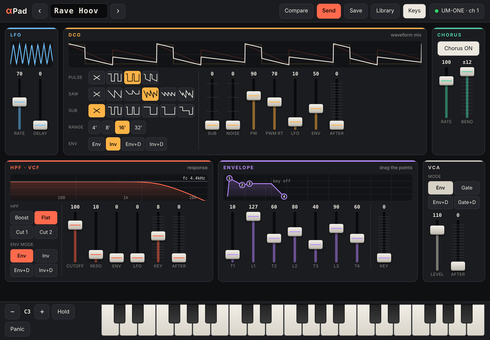

# AlphaPad

A touch controller and patch librarian for the Roland **Alpha Juno-1, Alpha Juno-2 and MKS-50**, built for iPad. It gives you the one-slider-per-parameter panel the synth never had, plus live graphics for the waveform mix, filter response, envelope and LFO.



## What it does

- **All 36 tone parameters on screen**: sliders, waveform pickers, range, HPF and envelope modes. Moving a control sends it to the synth instantly (Roland IPR SysEx), and turning the synth's alpha dial updates the screen.
- **Graphics**:
  - the DCO shows the combined pulse, saw, sub and noise waveform
  - the filter shows its frequency response, with the envelope target (dashed line) and the LFO sweep (shaded)
  - the envelope is drawn as a curve whose points you can drag
  - the LFO shows rate and delay fade-in
- **Library**:
  - Collections of tones, stored on the device.
  - Import `.syx` files: single tones (APR), full 64-tone banks (bulk dump) and handshake dumps all work.
  - Export a single tone or a 64-tone bank as `.syx`.
  - Comes with 16 original starter tones.
- **Getting tones onto the synth**:
  - Tap a tone to send it to the edit buffer. To keep it, press WRITE on the synth.
  - "Send bank to synth" bulk-loads a whole collection into the synth's 64 memory slots.
  - A bulk dump from the synth is received and saved as a new collection. Do this first as a backup.
- **Performance**:
  - Compare: hold to hear the tone as it was loaded.
  - Double-tap a slider to reset it.
  - On-screen keyboard with Hold and Panic.
  - Program Change, to pull a tone from the synth.

## Running it on an iPad

iPad Safari has no Web MIDI, so the iPad path is a small native wrapper.

**Option A: Swift Playgrounds (no Mac needed)**
1. Install **Swift Playgrounds** from the App Store.
2. Download this repo as a zip, then unzip it in the Files app.
3. Open `ios/AlphaPad.swiftpm`. Playgrounds opens it as an app project.
4. Press Run, or use "Install on Home Screen" from the app menu.

The wrapper hosts the same web UI. It connects it to CoreMIDI and saves the library in the app's Documents folder.

**Option B: Xcode on a Mac.** Open `ios/AlphaPad.swiftpm` in Xcode, choose your iPad, and run.

**Option C: a Web MIDI browser.** Open **https://jakehandy.github.io/alpha-ipad/** in an iOS browser app that adds Web MIDI. Desktop Chrome and Edge work directly. The Pages workflow publishes `web/` there on every push to `main`.

## Hooking up the synth

The Alpha Juno has 5-pin DIN MIDI, so you need a USB MIDI interface, for example a Roland UM-ONE in a USB-C or Lightning adapter. Connect both directions:

- the interface's OUT goes to the synth's MIDI IN, for control
- the synth's MIDI OUT goes to the interface's IN, for receiving tones and bank dumps

On the synth:
- **MIDI Exclusive ON**: without this, no SysEx goes in or out.
- MIDI channel: match it to the channel in the app's MIDI settings.
- **Memory Protect OFF**: needed only for bank loads.

## Protocol notes

All formats are in `web/js/juno.js`, and `tests/juno.test.js` checks them.

| Message | Bytes | Used for |
|---|---|---|
| IPR | `F0 41 36 0n 23 20 01 pp vv F7` | live single-parameter edits |
| APR | `F0 41 35 0n 23 20 01 <36 params> <10 name> F7` | full tone to or from the edit buffer |
| BLD | `F0 41 37 0n 23 20 01 00 aa <256 nibbles> F7` ×16 | 64-tone bank, 4 packed tones per block |

The packed 32-byte bank format was verified against a real factory bank. It decodes and re-encodes byte for byte. Run `node tests/juno.test.js path/to/bank.syx` to check any bank.

## Development

```
node tests/juno.test.js            # protocol tests
node tests/e2e.js <outdir> [bank]  # headless UI test with a mocked MIDI port (needs Playwright)
scripts/sync-ios.sh                # copy web/ into the iOS app after editing
```

The web app is plain HTML, CSS and JS with no build step, so it also runs from `file://` inside the iOS web view.

## Known limits

- The Swift wrapper was written without access to a Mac, so it has not been compiled yet. The JS side of the bridge is tested with a mock.
- The waveform drawings are sketches of each wave option. They are not oscilloscope captures.
- There are no write-to-slot SysEx messages for single tones on this synth. To save a single tone into synth memory, press WRITE on the synth.
